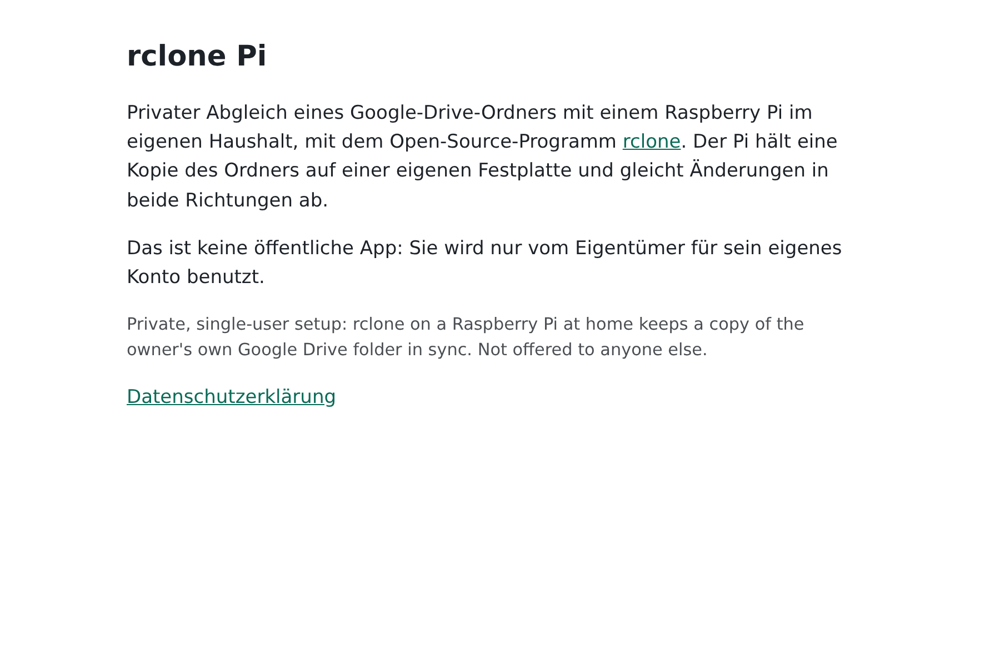
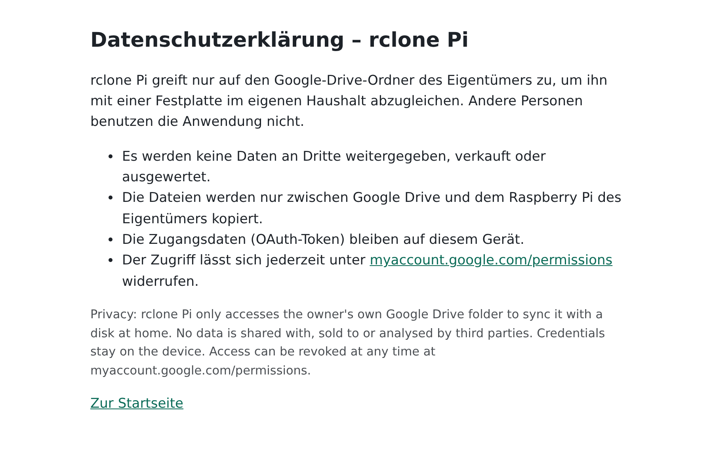
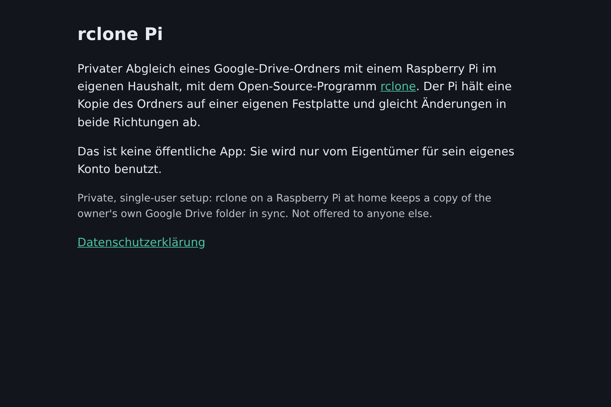
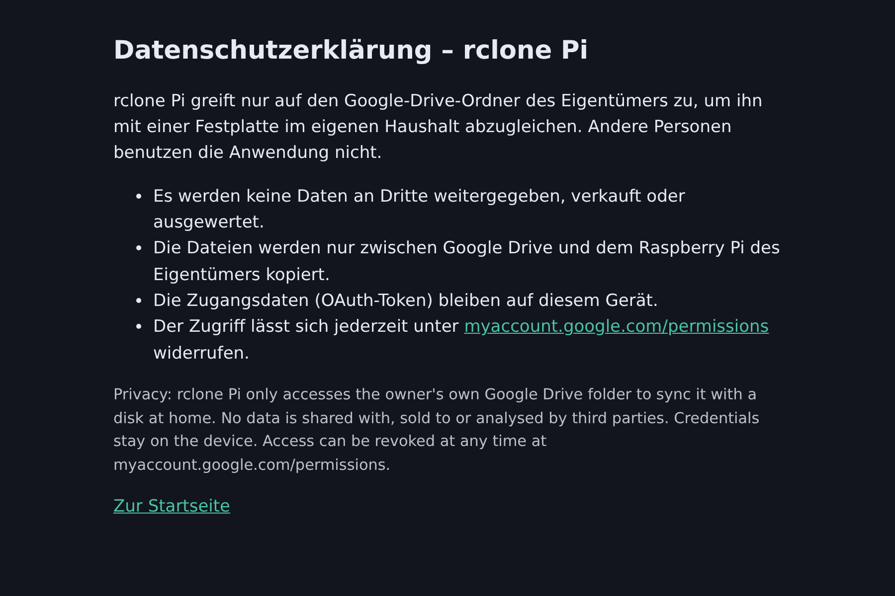

# rclone-pi

Startseite und Datenschutzerklärung für den eigenen Google-OAuth-Client von rclone auf einem privaten
Raspberry Pi (Abgleich eines Google-Drive-Ordners). Google verlangt beides, um den Client
„In Produktion“ zu stellen. Veröffentlicht über GitHub Pages:

- https://hermes-mal.github.io/rclone-pi/
- https://hermes-mal.github.io/rclone-pi/datenschutz.html

## Vorschau

So sehen die beiden Seiten aus (gerendert aus `index.html` und `datenschutz.html`, Chromium;
Farben folgen der Einstellung des Geräts).

| Startseite | Datenschutzerklärung |
|---|---|
|  |  |
|  |  |
